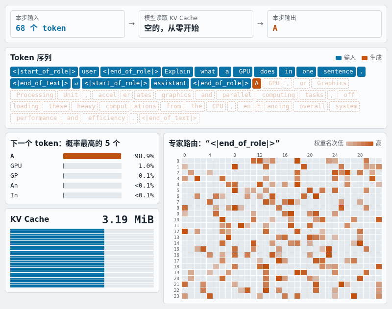

# 从 prompt 到 token：看懂大模型推理

[English](TUTORIAL.md)

这份教程沿着一次真实请求，讲清大模型推理在做什么：Prefill、Decode、KV Cache、Attention、RoPE、RMSNorm、MoE，以及它们为什么快或慢。最后讲 DeepSeek、Kimi、Qwen 等最新模型改了什么。

你只需要会一点 Python，知道矩阵乘法是什么。文中的代码都摘自 [`litemoe/`](litemoe)，示例模型是 Granite 3.1 1B。

**它不能教你的：** 训练、采样、调度、量化、多卡。LiteMoE 没有这些，高性能算子也是调用 vLLM 的。第 11 节列出了接着看什么。

## 目录

1. [一次请求的全貌](#1-一次请求的全貌)
2. [大模型是什么](#2-大模型是什么)
3. [Prefill、Decode 和 KV Cache](#3-prefilldecode-和-kv-cache)
4. [一层 Transformer：RMSNorm 和残差](#4-一层-transformerrmsnorm-和残差)
5. [Attention：QKV、GQA 和 RoPE](#5-attentionqkvgqa-和-rope)
6. [MoE：每个 token 只用一小部分专家](#6-moe每个-token-只用一小部分专家)
7. [组批和停止](#7-组批和停止)
8. [推理怎么变快](#8-推理怎么变快)
9. [怎么判断“真的变快，而且没变差”](#9-怎么判断真的变快而且没变差)
10. [最新模型改了什么](#10-最新模型改了什么)
11. [接着看什么](#11-接着看什么)

## 1. 一次请求的全貌

运行 `litemoe "What is the capital of Japan?"`，发生的是这些事：

```text
文本 → 聊天模板 → token id
     → Prefill：一次读完整个 prompt，算出第 1 个 token，填好 KV Cache
     → Decode：每步输入 1 个 token，算出下一个，循环
     → 遇到 EOS 或达到长度上限就停止
     → token id → 文本
```

入口在 [`generate.py`](litemoe/generate.py)，只有 40 多行，建议先读它。

下面是一次真实请求的录制：每一步的候选 token、KV Cache 增长，以及当前 token 在每层选了哪些专家。在[交互版](https://zhulinsen.github.io/LiteMoE/visualizer/?lang=zh)里可以逐步查看，也能点开任意 token。



## 2. 大模型是什么

**Token。** 模型不认识文字，只认识整数。分词器把文本切成 token 再编号。Granite 1B 的词表有 49155 个 token。

**Embedding。** 每个 token id 对应一个向量，1B 里是 1024 维。之后的所有计算都在这些向量上进行。

**Layer。** 模型由多层结构相同的模块堆叠而成，1B 有 24 层。每层读入 `(batch, 序列长度, 1024)` 的张量，输出同样形状的张量。

**Logits。** 最后一层的向量再乘一个矩阵，得到 49155 个分数，每个 token 一个。分数越高，模型越认为它是下一个 token。

**参数。** 这些矩阵里的数字就是参数，“1B”指约 10 亿量级。训练负责调整它们，推理只读取，不修改。

**贪心和采样。** LiteMoE 总是选分数最高的 token，也就是贪心，所以相同输入的结果基本可复现。产品通常用 temperature、top-p 按概率采样，让回答更多样。

所以模型做的只有一件事：**给定前面所有 token，预测下一个。** 生成文本就是把这件事重复很多次。

## 3. Prefill、Decode 和 KV Cache

### 为什么要分两个阶段

如果每生成一个 token，都把全部历史重算一遍，成本会随长度快速上升。其实历史 token 的中间结果可以保存，这个缓存就是 **KV Cache**（Attention 里的 Key 和 Value，第 5 节会讲）。

于是推理分成两个阶段：

| | Prefill | Decode |
|---|---|---|
| 每次输入 | 整个 prompt，比如 2000 个 token | 1 个 token |
| 对 KV Cache | 一次写入全部 prompt | 每步追加 1 个位置，并读取全部历史 |
| 主要瓶颈 | 算力 | 内存带宽和每步开销 |
| 用户感受到的指标 | TTFT，首 token 延迟 | ITL，token 间隔 |

### 看代码

每一步 Decode 就是下面这段。先看懂它，`forward` 里的细节以后再说：

```python
# litemoe/engine.py
    def decode_step(self):
        s = self.state
        valid = s["active"].clone()
        positions = torch.where(valid, s["length"], 0)[:, None]
        logits = self.model.forward(s["next"][:, None], positions, valid[:, None], self.cache)
        candidate = logits[:, 0].argmax(-1)
```

`s["next"]` 是上一步选出的 token，`positions` 是它在序列中的位置，`argmax` 选出下一个 token。这就是生成循环的核心。

### KV Cache 有多大

[`cache.py`](litemoe/cache.py) 里只有一个预先分配好的大张量：

```python
# litemoe/cache.py
        h, d = cfg.num_key_value_heads, cfg.hidden_size // cfg.num_attention_heads
        shape = (cfg.num_hidden_layers, batch, h, capacity, d)
        self.k = torch.zeros(shape, dtype=dtype, device=device)
```

算一下 1B（BF16，每个数 2 字节）：

```text
每个 token 每层：8 个 KV 头 × 64 维 × 2（K 和 V）× 2 字节 = 2048 字节
每个 token 全部层：2048 × 24 层 = 49152 字节，约 48 KB
4096 个 token：约 192 MiB
```

一个 1B 小模型都要这么多。如果上下文到一百万 token，模型又大得多，KV Cache 就成了主要成本。这正是第 10 节里多数新模型在解决的问题。

## 4. 一层 Transformer：RMSNorm 和残差

每层的结构在 [`model.py`](litemoe/model.py) 的 `forward` 里。去掉优化分支后是这样：

```text
z = RMSNorm(x)
x = x + 系数 × Attention(z)      ← 让 token 看其他 token
z = RMSNorm(x)
x = x + 系数 × MoE(z)            ← 对每个 token 单独做非线性变换
```

**残差（`x + ...`）。** 每层只计算一个增量，再加回原值。这样信息和梯度能穿过很多层，深层网络才训练得动。第 10 节的 mHC 和 Attention Residuals 改的就是这里。

**RMSNorm。** 把向量缩放到稳定的尺度，再乘一组可学习的权重。不做归一化，数值在几十层之后容易失控。代码只有两行：

```python
# litemoe/model.py
def rmsnorm(x, weight, eps):
    z = x.float()
    return (z * torch.rsqrt(z.square().mean(-1, keepdim=True) + eps)).to(x.dtype) * weight
```

自己试一下，缩放后每个向量的均方根都接近 1：

```python
# 可直接运行
import torch
x = torch.tensor([[3.0, 4.0], [300.0, 400.0]])
z = x * torch.rsqrt(x.square().mean(-1, keepdim=True) + 1e-6)
print(z)                                        # 两行几乎相同
print(z.square().mean(-1).sqrt())               # 都约等于 1
```

代码里先转成 FP32 再计算，以减少 BF16 的舍入误差。这类细节在推理里很常见，第 8 节会再遇到。

## 5. Attention：QKV、GQA 和 RoPE

Attention 让每个 token 去“看”前面的 token，决定该从哪里取信息。

### Q、K、V

每个 token 的向量经过三个矩阵，得到三个新向量：

- **Query（Q）：** 我在找什么。
- **Key（K）：** 我能提供什么。
- **Value（V）：** 我的实际内容。

Q 和每个 K 算相似度，归一化成权重，再用权重对 V 加权求和：

```text
Attention(Q, K, V) = softmax(Q·Kᵀ × scale) · V
```

过去 token 的 K 和 V 不会再变，所以可以缓存；Q 只属于当前 token，用完就丢。这就是它叫 KV Cache 而不是 QKV Cache 的原因。

### 多头和 GQA

向量被切成多个“头”分别计算，让模型同时关注不同的关系。1B 的 1024 维切成 16 个头，每头 64 维。

标准做法是 Q、K、V 的头数相同。**GQA（分组查询注意力）** 让多个 Q 头共用一组 K、V。1B 有 16 个 Q 头、8 个 KV 头，KV Cache 因此减半，这也是第 3 节用 8 而不是 16 计算的原因。

```python
# litemoe/model.py
        q = q.view(b, s, cfg.num_attention_heads, d).transpose(1, 2)
        k = k.view(b, s, cfg.num_key_value_heads, d).transpose(1, 2)
        v = v.view(b, s, cfg.num_key_value_heads, d).transpose(1, 2)
```

### RoPE：告诉模型 token 的顺序

Attention 的公式里没有位置信息，它本身分不清 token 的先后。**RoPE（旋转位置编码）** 按位置把 Q 和 K 的每对维度旋转一个角度，位置越靠后转得越多：

```python
# litemoe/model.py
def rotate_half(x):
    a, b = x.chunk(2, dim=-1)
    return torch.cat((-b, a), dim=-1)
```

```python
# litemoe/model.py
            q, k = q * cos + rotate_half(q) * sin, k * cos + rotate_half(k) * sin
```

这是二维旋转公式在每对维度上的应用。妙处在于：两个向量的内积只取决于**旋转角度之差**，所以 Q 和 K 的相似度自然就只和两者的相对距离有关。

注意 RoPE 只作用于 Q 和 K，V 不旋转。缓存的 K 已经转好了，以后不用重算。

## 6. MoE：每个 token 只用一小部分专家

### 想解决什么

模型越大，能力通常越强，但每个 token 的计算量也越大。**MoE（混合专家）** 把两者分开：总参数很多，每个 token 只用其中一小部分。

```text
1B 每层：32 个专家，每个 token 选 8 个
专家参数合计约 12 亿，但每个 token 只激活约 3 亿
```

“专家”这个名字有误导性。它不是“数学专家”“代码专家”，也不是按回答领域划分，而是**每个 token、每一层**都独立选择的一组小网络。一句话里的不同 token 常常走向不同的专家。

### 三步：路由、计算、合并

**第 1 步，路由。** Router 是一个线性层，给每个专家打分，取前 8 名，用 softmax 算出权重：

```python
# litemoe/model.py
                top, ids = scores.float().topk(cfg.num_experts_per_tok, dim=-1)
                scales = top.softmax(-1)
```

**第 2 步，计算。** 把选了同一个专家的 token 分到一组，一起计算。每个专家是一个 SwiGLU 网络，一半向量做门控，另一半是内容：

```python
# litemoe/ops.py
            gate, up = linear_rows(rows, w1[local], singleton).chunk(2, -1)
            y = linear_rows(F.silu(gate) * up, w2[local], singleton)
```

**第 3 步，合并。** 按权重把 8 个专家的输出加回对应的 token。

下面这段可以直接运行，看路由的形状：

```python
# 可直接运行
import torch
tokens, experts, topk = 3, 8, 2
scores = torch.randn(tokens, experts)           # Router 的输出
top, ids = scores.topk(topk, dim=-1)
print(ids)                                      # 每个 token 选了哪些专家
print(top.softmax(-1))                          # 每行的权重之和为 1
```

### 为什么 MoE 难做快

- **工作量不均匀。** 每个专家这一步分到多少 token 事先不知道，同一个 GPU kernel 要处理不规则的分组。
- **内存读取分散。** 权重分布在很多专家矩阵上，缓存不容易命中。
- **分到多卡要通信。** 专家放在不同 GPU 上时，token 要来回传输。

所以实测里专家计算是 Decode 的最大开销，约占 35～40%。`ops.py` 的 `reference_experts` 是纯 Python 版，便于阅读；默认路径调用 vLLM 的融合 kernel，把三步合进一次计算。

## 7. 组批和停止

同时处理多个请求，GPU 利用率更高，这叫组批（batch）。但请求的长度和结束时间都不同，会带来两个问题。

**Padding。** Prompt 长短不一，传统做法是补齐后用掩码忽略补位，长请求越多，浪费越大。LiteMoE 的快路径把所有 token 拼成一个长序列，再用每个序列的边界做注意力，见 [`packed.py`](litemoe/packed.py)。

**有人先结束。** 每个请求的 `active` 状态单独记录。已结束的位置还留在批次里，但不再写入 KV，输出也不会发布。这里 LiteMoE 用的是最简单的固定批次：跑完这批才返回，不能中途加入新请求。线上服务要用**连续批处理**，这是 vLLM 这类框架的调度器做的事，LiteMoE 没有。

**一个反直觉的事实。** 同一个问题单独运行和放进批次运行，输出常常不同。我们测的 16 个样例里，LiteMoE 只有 3～5 个完全相同，vLLM 和 HF 也差不多。舍入受批次影响，由此产生的分数差异可能改变 `argmax`，之后的文本就分叉了。可视化页面底部有一个真实例子：同一个问题，参考路径和快路径从第 20 个 token 开始走向不同的回答。DeepSeek 开源的 [DeepInfer](https://github.com/deepseek-ai/DeepInfer) 把“批次不变推理”列为一项功能，可见这件事并不简单。

## 8. 推理怎么变快

先建立一个判断：**Decode 里 GPU 真正的数学运算之外，还有大量可以省的工作。**

LiteMoE 和 vLLM 用的是同样的专家、注意力和路由算子，但固定批次下吞吐高 5～9%（A100 108.8%，L4 105.3%），差距主要来自算子之外的部分。

### CUDA Graph：把一步录下来重放

普通执行时，CPU 每一步都要逐个发起几十个 GPU 操作，这些都有开销。[`execution.py`](litemoe/execution.py) 把整个 Decode 步骤录制成一张图，之后每步只需要“重放”：

```python
# litemoe/execution.py
    graph = torch.cuda.CUDAGraph()
    with torch.cuda.graph(graph, stream=stream):
        step()
```

代价是形状必须固定，换了批次大小就要重录。

### 异步取回输出：不让 CPU 拖住 GPU

每步要把新 token 从 GPU 拿到 CPU，如果同步等待，GPU 就会空转。`OutputRing` 用两组缓冲轮流异步拷贝，GPU 可以接着算下一步。

### Lean Decode：删除不影响结果的工作

这是最大的一项优化，核心思想是：**已结束的请求，算错了也没关系，只要不影响别人。**

普通路径上，每层都要做掩码、把专家编号映射到实际存储位置、并复制输出，以保证已结束的位置也得到干净的结果。Lean Decode 把这些删掉，因为有三条保证：

1. 已结束请求的位置被置 0。
2. KV 写入受掩码保护，不会污染缓存。
3. 无效位置的输出永远不发布。

```python
# litemoe/optimized.py
    # Stopped rows have zero positions and masked KV writes, and their logits are never published.
```

这种“证明某项工作没必要”的思路，比微调算子更值钱。

### 其他优化

| 优化 | 做法 | 开发时测得的收益 |
|---|---|---|
| Lean Decode | 上面所说 | A100 +15～19%，L4 +4～6% |
| Lean Prefill | 无 padding 的拼接 Prefill | +3.5% |
| FP32 路由权重 | 路由权重不转 BF16 | 1B +2.65% |
| 残差用 `add(alpha=)` | 一次运算完成乘加 | +2.3% |
| A100 kernel 分块 | 专门调过的 tile 参数 | A100 +1～2%，但 L4 -4～5%，所以只在 A100 启用 |

这些是开发过程中逐项测的，条件不完全相同，不能直接相加。最后一行说明了一件事：**性能优化常常绑定硬件，在一张卡上有效不代表到处有效。**

### 优化不是免费的

快路径改变了 BF16 的舍入顺序，输出和参考实现不再逐位相同。而为此保留的开关（`decode_lean`、`prefill_lean` 等）也让 `model.py` 更难读。速度、数值、可读性之间一直要权衡。

## 9. 怎么判断“真的变快，而且没变差”

这一节也许比前面都重要。很多性能数字不可信，不是因为造假，而是因为方法不严。

**性能怎么测。**

- **同一次分配。** 不同机器、不同时段差异很大，所以 LiteMoE 和 vLLM 在同一张卡上先后运行。
- **固定输入和预热。** 输入文件固定，前 3 次不计，取 5 次的中位数。
- **多个场景取几何平均。** 单点最高 119%，混合长度只有 100% 左右，只报最高值就是误导。
- **接受波动。** 同一张卡重复跑，几何平均差约 0.5 个百分点，单点差异可达 4～5 个百分点。比这更小的提升，要多次测量才能相信。

**质量怎么测。** 我们走过一段弯路，值得讲讲：

1. 先用 GSM8K 数学题前 500 题比较准确率，并**事先定好标准**：差值 95% 置信区间的下限不低于 -3 个百分点。
2. 结果 7 组比较里 6 组没过。每组差值都在噪声范围内，但 LiteMoE 从没领先，不能说没问题。
3. 没有改标准，而是把样本加大到全部 1319 题：LiteMoE 46.2%，vLLM 47.2%，差值 -0.9（-2.9～+1.1），通过。
4. 其中后 819 题此前没用过，单独看差值是 -0.9（-3.4～+1.7）。结论写成“未检测到损失”，而不是“没有损失”，因为最多约 3 个百分点的下降仍不能排除。

**三个教训：**

- **先定标准，再看结果。** 否则总能找到让自己满意的解释。
- **“能跑”和“质量对”是两回事。** 程序通过所有测试，准确率也可能悄悄下降。
- **没有差异不等于证明相同。** 样本量决定你能看到多小的差距。

完整数据在 [`benchmarks/README.md`](benchmarks/README.md)，运行 `bash tools/reproduce.sh` 可以自己复现。

## 10. 最新模型改了什么

> 资料截至 2026 年 11 月，以论文和官方模型页为准。性能数字大多是厂商自报，未经独立验证。LiteMoE 目前只支持 Granite，这些架构都还没有实现。

### 主线：成本从“生成”转向“读上下文”

智能体（agent）会读大量文件和工具输出，一次请求的输入远多于输出，上下文达到百万 token。DeepSeek 在 V4.1-Flash 的论文里说得很直接：Prefill 算力和 KV Cache 的内存、带宽，已经成了部署成本的主要障碍。

用第 3 节的公式看，就明白压力有多大：如果按 1B 每 token 48 KB 计算，一百万 token 的 KV Cache 约 46 GiB，这还只是个 1B 小模型。接下来的创新大多围着这一点转。

### 模型一览

| 模型 | 总参数 / 每 token 激活 | 专家 | 注意力 | 上下文 |
|---|---|---|---|---|
| DeepSeek-V4-Pro | 1.6T / 49B | — | CSA + HCA 混合 | 1M |
| DeepSeek-V4.1-Flash | 主干 552B / Decode 16B、Prefill 8B | — | CSA2 + 滑动窗口 | 1M |
| Kimi K3 | 2.8T / 104B | 896 选 16，另有 2 个共享 | 69 层 KDA + 24 层 Gated MLA | 1M |
| Qwen3.8-2.4T-A95B | 2.4T / 95B | 512 选 10，另有 1 个共享 | Gated DeltaNet 和 Gated Attention 3:1 | 262K，可扩展到约 1M |
| GLM-5 | 744B / 40B | 256 | MLA + DeepSeek 稀疏注意力 | — |
| MiniMax M2.5 | 230B | — | 纯 GQA，没有额外的效率设计 | — |
| Granite 3.1 1B（对照） | 约 1B | 32 选 8 | GQA | 本项目限 4096 |

### 创新 1：更大、更细的 MoE

DeepSeek 系列推广了一种做法：很多个小专家，每次激活一部分，再加少量所有 token 都用的**共享专家**。现在大模型几乎都走这条路，差别在规模：Granite 1B 是 32 选 8，Kimi K3 是 896 选 16。

对应第 6 节：专家越多越细，路由和分组的调度负担越重，多卡通信也更复杂。所以 Arcee Trinity Large 反其道而行，把专家做粗一些，换取推理吞吐。

### 创新 2：压缩 KV Cache

这是最激烈的方向。对照第 3 节，大家在从不同角度缩小那个张量。

- **MLA（DeepSeek-V2、V3）：** 不存完整的 K 和 V，只存一个低维隐向量，用的时候再投影回去。
- **CSA 和 HCA（DeepSeek-V4）：** CSA 把每 m 个 token 的 KV 压成一项，用 Lightning Indexer 挑出 top-k 项做注意力，再加一段未压缩的滑动窗口处理局部依赖。HCA 压缩得更狠，但保留稠密注意力。论文称，在百万 token 下，V4-Pro 的 KV Cache 只有 V3.2 的 10%。
- **CSA2 跨层复用（V4.1-Flash）：** 不必每层都算自己的 KV。各层静态分成三种模式：Full 自己算全部，Reindex 复用前面的 KV 但重新挑选，Reuse 连挑选结果也复用。
- **FP4 KV 缓存（V4.1-Flash）：** 主 KV 用 4 位浮点，配合量化感知训练。滑动窗口的 KV 对量化敏感，仍用 FP8。

**结果：** V4.1-Flash 的全局 KV 占显存约 **890 字节/token**，约为 V4-Flash 的 1/4；SSD 或内存上的持久化 KV 约为 1/8。Granite 1B 是约 48 KB/token，差了 50 多倍（两者的统计范围不完全相同，只看量级）。

### 创新 3：线性注意力

既然 KV Cache 随长度增长是问题，那能不能不存？

**Gated DeltaNet** 和 **KDA（Kimi Delta Attention）** 用一个**固定大小的状态**代替不断增长的 KV，像 RNN 一样边读边更新。代价是记忆有限，表达能力弱于完整注意力，所以都和普通注意力混用，比例约 3:1：

```text
Qwen3.8：23 × ( 3 × (Gated DeltaNet → MoE) → 1 × (Gated Attention → MoE) )
Kimi K3：69 层 KDA + 24 层 Gated MLA
```

Kimi Linear 论文称 KV Cache 最多减少 75%，百万 token 下 Decode 吞吐最高提升 6 倍。

### 创新 4：重新设计残差

第 4 节的 `x = x + 系数 × 输出` 用了十年，现在也开始变了。

- **mHC（DeepSeek-V4）：** 把残差流加宽成多路，再把混合矩阵约束在双随机矩阵上，保证数值稳定。
- **Single-Pass mHC（V4.1-Flash）：** 原始做法多跑一遍激活数据，论文改用上一层的系数来消除这个依赖，内存流量减半，称性能损失可忽略。这是一个**为推理成本修改架构**的好例子。
- **Attention Residuals（Kimi）：** 每层用注意力从前面各层的输出里选择性地取用，而不是固定相加。Kimi K3 用的是按块分组的省内存版本。

### 创新 5：让 Prefill 比 Decode 便宜

**Causal Encoder-Decoder（V4.1-Flash）** 是个很漂亮的想法：40 层分成前后各 20 层，后半部分的全局 KV 从第 20 层的输出投影得到，因此 Prefill 只需跑前 20 层。结果 Prefill 每 token 激活 8B，Decode 激活 16B。这和第 3 节的两阶段对应：模型结构本身开始区分它们了。

**Engram（DeepSeek）** 把一部分“记忆”从计算中分出来：用 N-gram 哈希查表获取嵌入，查询地址是确定的，所以可以从主机内存预取。

### 创新 6：一次预测多个 token

Decode 一次只出一个 token 太慢。

- **MTP（多 token 预测）：** 训练时让模型同时预测后面几个 token。DeepSeek-V4 和 Qwen3.8 都用了；多数模型只在训练时用，Step 3.5 Flash 在推理时也用。
- **推测解码：** 让一个小模型先猜几个 token，大模型一次验证，猜对就省了多步 Decode。DeepSeek 的 **DSpark** 用 3 层小网络一次起草 5 个位置，并预测每个位置的置信度，由调度器决定验证多长。vLLM 团队也参与了 EAGLE 3.1。

### 创新 7：更低精度

量化早就有了，变化在于它现在进入了**模型设计阶段**。Kimi K3 的权重用 MXFP4、激活用 MXFP8，并从训练阶段就做量化感知；V4.1-Flash 对 KV 用 FP4。低精度不再是部署时才做的事后压缩。

### 创新 8：服务架构

- **Prefill / Decode 分离：** 第 3 节说两阶段的瓶颈不同，那就放到不同的 GPU 上。长 prompt 不再卡住别人的 Decode。vLLM 的博客给出的案例里，8 卡 MI300X 节点在同样的延迟目标下，达标请求从 30% 升到 73%。但 KV 传输慢时反而更差，同一篇文章的 L40S 测试中，首 token 中位延迟从 0.7 秒涨到 2.2 秒。
- **KV Cache 分层：** V4.1-Flash 把全局 KV 保留至少 72 小时，滑动窗口的 KV 只保留几分钟。这直接关系到 prefix cache 的命中率和成本。
- **开源生产框架：** DeepSeek 开源了 DeepInfer，它支持 V4.1-Flash，开源版只提供离线推理，KV Cache 系统和分离式服务不包含在内。

### 怎么和本教程对应

| 新技术 | 改的是哪部分 | 本教程 |
|---|---|---|
| MLA、CSA、CSA2、FP4 KV | `KVCache` 的形状和内容 | 第 3、5 节 |
| Gated DeltaNet、KDA | `attention` 函数本身 | 第 5 节 |
| mHC、Attention Residuals | `x = x + ...` 这一行 | 第 4 节 |
| 更多专家、共享专家 | 路由和分组 | 第 6 节 |
| Causal Encoder-Decoder | Prefill 的层数 | 第 3 节 |
| MTP、DSpark | 每步生成几个 token | 第 3 节 |
| Prefill / Decode 分离 | 两阶段放到哪里运行 | 第 3 节 |

这也是这份教程想传达的：**基础结构没有变，新模型都是在换其中某个零件。** 看懂了这条流水线，再读新论文，你会先问：它在解决哪个瓶颈，又把代价转移到了哪里？

## 11. 接着看什么

**读代码的顺序：**

1. `generate.py`：入口。
2. `engine.py` 的 `generate` 和 `decode_step`：生成循环。
3. `model.py` 的 `forward` 和 `attention`，忽略所有 `lean`、`flash`、`packed` 分支。
4. `cache.py` 和 `ops.py` 的 `reference_experts`：KV Cache 和专家。
5. `optimized.py`、`execution.py`：最后再看优化。

**LiteMoE 没有的，去这里看：**

| 主题 | 去哪里 |
|---|---|
| 连续批处理、调度、线上服务 | [vLLM](https://github.com/vllm-project/vllm) |
| 从零训练一个 Transformer | [nanoGPT](https://github.com/karpathy/nanoGPT) |
| 量化和 CPU 推理 | [llama.cpp](https://github.com/ggml-org/llama.cpp) |
| 新模型的架构对比 | [Sebastian Raschka 的综述](https://magazine.sebastianraschka.com/p/a-dream-of-spring-for-open-weight) |

**第 10 节的资料来源：**

- [DeepSeek-V3](https://arxiv.org/abs/2412.19437)
- [DeepSeek-V4](https://arxiv.org/html/2606.19348v1)
- [DeepSeek-V4.1-Flash](https://arxiv.org/abs/2609.19969)
- [DeepInfer](https://github.com/deepseek-ai/DeepInfer)
- [Kimi K3 官方仓库](https://github.com/MoonshotAI/Kimi-K3)
- [Kimi Linear（KDA）](https://arxiv.org/abs/2510.26692)
- [Attention Residuals](https://arxiv.org/abs/2603.15031)
- [Qwen3.8 模型页](https://huggingface.co/Qwen/Qwen3.8-2.4T-A95B)
- [vLLM：Prefill / Decode 分离指南](https://vllm.ai/blog/2026-09-29-disaggregated-serving-guide)
