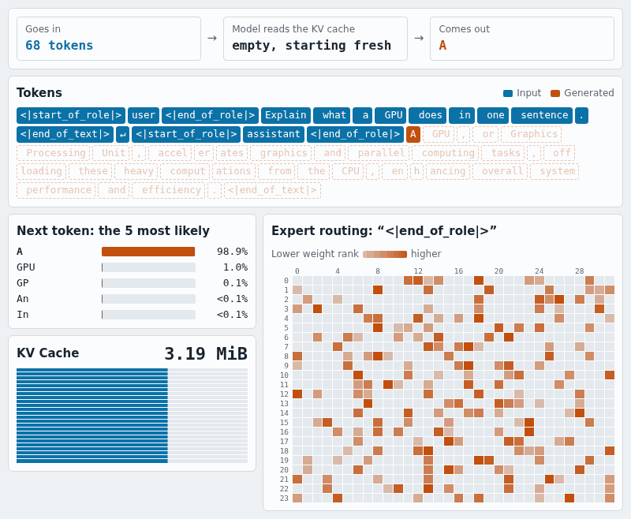

# From prompt to token: how LLM inference works

[中文](tutorial.zh-CN.md) · **[Interactive demo](https://zhulinsen.github.io/LiteMoE/visualizer/?lang=en)**

This tutorial follows one real request to explain what LLM inference does: prefill, decode, the KV cache, attention, RoPE, RMSNorm and MoE, and why each is fast or slow. It ends with what the latest models from DeepSeek, Kimi, Qwen and others changed.

You need some Python and to know what matrix multiplication is. All code comes from [`litemoe/`](../litemoe), and the example model is Granite 3.1 1B.

**What it won't teach you:** training, sampling, scheduling, quantization and multi-GPU. LiteMoE has none of these, and its high-performance kernels come from vLLM. Section 11 lists where to go next.

## Contents

1. [One request from start to finish](#1-one-request-from-start-to-finish)
2. [What an LLM is](#2-what-an-llm-is)
3. [Prefill, decode and the KV cache](#3-prefill-decode-and-the-kv-cache)
4. [One Transformer layer: RMSNorm and residuals](#4-one-transformer-layer-rmsnorm-and-residuals)
5. [Attention: QKV, GQA and RoPE](#5-attention-qkv-gqa-and-rope)
6. [MoE: each token uses a few experts](#6-moe-each-token-uses-a-few-experts)
7. [Batching and stopping](#7-batching-and-stopping)
8. [How inference gets faster](#8-how-inference-gets-faster)
9. [Is it really faster, and no worse?](#9-is-it-really-faster-and-no-worse)
10. [What the latest models changed](#10-what-the-latest-models-changed)
11. [Where to go next](#11-where-to-go-next)

## 1. One request from start to finish

When you run `litemoe "What is the capital of Japan?"`, this happens:

```text
text → chat template → token ids
     → prefill: read the whole prompt at once, compute the first token, fill the KV cache
     → decode: feed in 1 token per step, compute the next one, repeat
     → stop at EOS or the length limit
     → token ids → text
```

The entry point is [`generate.py`](../litemoe/generate.py). It's only about 40 lines, so read it first.

Below is a recording of a real request: the candidate tokens at each step, the KV cache growing, and the experts the current token picks in each layer. In the [interactive version](https://zhulinsen.github.io/LiteMoE/visualizer/?lang=en) you can step through the run and click any token.



## 2. What an LLM is

**Token.** A model works with integers, not text. A tokenizer splits text into tokens and numbers them. Granite 1B has 49155 tokens in its vocabulary.

**Embedding.** Each token id maps to a vector, 1024-dimensional in 1B. All later computation happens on these vectors.

**Layer.** A model is a stack of identically structured layers, 24 in 1B. Each layer takes a `(batch, sequence length, 1024)` tensor and outputs one of the same shape.

**Logits.** The final vector is multiplied by one more matrix to get 49155 scores, one per token. A higher score means the model considers that token a likelier next token.

**Parameters.** The numbers in these matrices are the parameters, and "1B" means about a billion of them. Training adjusts them. Inference only reads them.

**Greedy and sampling.** LiteMoE always picks the highest-scoring token. This is greedy decoding, so the same input largely reproduces the same result. Products usually sample with temperature and top-p to vary their answers.

So the model does just one thing: **given all the previous tokens, predict the next one.** Generating text repeats that many times.

## 3. Prefill, decode and the KV cache

### Why two phases

Recomputing the whole history for every new token gets expensive quickly as the text grows. But the intermediate results for past tokens can be kept. That store is the **KV cache**, named after the Key and Value in attention (section 5).

So inference has two phases:

| | Prefill | Decode |
|---|---|---|
| Input per call | The whole prompt, such as 2000 tokens | 1 token |
| KV cache | Writes the whole prompt at once | Appends 1 position per step and reads all history |
| Main bottleneck | Compute | Memory bandwidth and per-step overhead |
| What users feel | TTFT, time to first token | ITL, inter-token latency |

### The code

Each decode step is the code below. Understand this first and leave the details of `forward` for later:

```python
# litemoe/engine.py
    def decode_step(self):
        s = self.state
        valid = s["active"].clone()
        positions = torch.where(valid, s["length"], 0)[:, None]
        logits = self.model.forward(s["next"][:, None], positions, valid[:, None], self.cache)
        candidate = logits[:, 0].argmax(-1)
```

`s["next"]` is the token picked in the previous step, `positions` is its place in the sequence, and `argmax` picks the next token. This is the core of the generation loop.

### How big is the KV cache?

[`cache.py`](../litemoe/cache.py) holds one large preallocated tensor:

```python
# litemoe/cache.py
        h, d = cfg.num_key_value_heads, cfg.hidden_size // cfg.num_attention_heads
        shape = (cfg.num_hidden_layers, batch, h, capacity, d)
        self.k = torch.zeros(shape, dtype=dtype, device=device)
```

Here is the math for 1B, with BF16 using 2 bytes per number:

```text
Per token, per layer: 8 KV heads × 64 dims × 2 (K and V) × 2 bytes = 2048 bytes
Per token, all layers: 2048 × 24 layers = 49152 bytes, about 48 KB
4096 tokens: about 192 MiB
```

That's a small 1B model. With a million tokens of context and a much bigger model, the KV cache becomes a main cost. Most of the new models in section 10 are working on exactly this.

## 4. One Transformer layer: RMSNorm and residuals

Each layer's structure is in `forward` in [`model.py`](../litemoe/model.py). Without the optimization branches, it looks like this:

```text
z = RMSNorm(x)
x = x + coefficient × Attention(z)      ← lets tokens see other tokens
z = RMSNorm(x)
x = x + coefficient × MoE(z)            ← a nonlinear transform of each token on its own
```

**Residuals (`x + ...`).** Each layer computes only an increment and adds it back to the input. Information and gradients can then pass through many layers, which is what makes deep networks trainable. mHC and Attention Residuals in section 10 change exactly this part.

**RMSNorm.** It scales a vector to a stable size, then multiplies by learned weights. Without normalization, values tend to run out of control after dozens of layers. The code is two lines:

```python
# litemoe/model.py
def rmsnorm(x, weight, eps):
    z = x.float()
    return (z * torch.rsqrt(z.square().mean(-1, keepdim=True) + eps)).to(x.dtype) * weight
```

Try it. After scaling, each vector's root mean square is close to 1:

```python
# Runnable as-is
import torch
x = torch.tensor([[3.0, 4.0], [300.0, 400.0]])
z = x * torch.rsqrt(x.square().mean(-1, keepdim=True) + 1e-6)
print(z)                                        # the two rows are nearly identical
print(z.square().mean(-1).sqrt())               # both about 1
```

The code converts to FP32 before computing, to reduce BF16 rounding error. Details like this are common in inference, and they come back in section 8.

## 5. Attention: QKV, GQA and RoPE

Attention lets each token look at earlier tokens and decide where to take information from.

### Q, K and V

Three matrices turn each token's vector into three new vectors:

- **Query (Q):** what I'm looking for.
- **Key (K):** what I can offer.
- **Value (V):** my actual content.

Q is compared with every K. The similarities are normalized into weights, which then give a weighted sum of the Vs:

```text
Attention(Q, K, V) = softmax(Q·Kᵀ × scale) · V
```

The K and V of past tokens never change, so they can be cached. Q belongs only to the current token and is discarded after use. That's why it's a KV cache and not a QKV cache.

### Multiple heads and GQA

The vector is split into several "heads" computed separately, so the model can track different relationships at once. 1B splits its 1024 dimensions into 16 heads of 64.

Normally Q, K and V have the same number of heads. **GQA (grouped-query attention)** lets several Q heads share one set of K and V. 1B has 16 Q heads and 8 KV heads, which halves the KV cache. That's why section 3 used 8 and not 16.

```python
# litemoe/model.py
        q = q.view(b, s, cfg.num_attention_heads, d).transpose(1, 2)
        k = k.view(b, s, cfg.num_key_value_heads, d).transpose(1, 2)
        v = v.view(b, s, cfg.num_key_value_heads, d).transpose(1, 2)
```

### RoPE: telling the model the order of tokens

The attention formula has no position information, so by itself it can't tell which token came first. **RoPE (rotary position embedding)** rotates each pair of dimensions in Q and K by an angle that grows with position:

```python
# litemoe/model.py
def rotate_half(x):
    a, b = x.chunk(2, dim=-1)
    return torch.cat((-b, a), dim=-1)
```

```python
# litemoe/model.py
            q, k = q * cos + rotate_half(q) * sin, k * cos + rotate_half(k) * sin
```

This is the 2D rotation formula applied to each pair of dimensions. The neat part is that the inner product of two vectors depends only on the **difference between their rotation angles**, so the similarity of Q and K depends only on their relative distance.

RoPE acts only on Q and K, never on V. The cached K is already rotated, so it never needs recomputing.

## 6. MoE: each token uses a few experts

### The problem it solves

Bigger models are usually more capable, but they also cost more compute per token. **MoE (mixture of experts)** separates the two: many parameters in total, with each token using only a small share of them.

```text
1B, per layer: 32 experts, each token picks 8
About 1.2B expert parameters in total, about 0.3B active per token
```

The name "expert" misleads. These aren't "math experts" or "code experts", and they aren't divided by subject. They're small networks chosen independently for **each token in each layer**. Different tokens in one sentence often go to different experts.

### Three steps: route, compute, combine

**Step 1, route.** The router is a linear layer that scores every expert. It takes the top 8 and computes their weights with softmax:

```python
# litemoe/model.py
                top, ids = scores.float().topk(cfg.num_experts_per_tok, dim=-1)
                scales = top.softmax(-1)
```

**Step 2, compute.** Tokens that chose the same expert are grouped and computed together. Each expert is a SwiGLU network, where half the vector acts as a gate and the other half as content:

```python
# litemoe/ops.py
            gate, up = linear_rows(rows, w1[local], singleton).chunk(2, -1)
            y = linear_rows(F.silu(gate) * up, w2[local], singleton)
```

**Step 3, combine.** The 8 expert outputs are added back to their tokens according to the weights.

You can run this to see the shape of routing:

```python
# Runnable as-is
import torch
tokens, experts, topk = 3, 8, 2
scores = torch.randn(tokens, experts)           # router output
top, ids = scores.topk(topk, dim=-1)
print(ids)                                      # the experts each token picked
print(top.softmax(-1))                          # each row's weights sum to 1
```

### Why MoE is hard to speed up

- **Uneven work.** How many tokens each expert gets in a step isn't known in advance, so one GPU kernel has to handle irregular groups.
- **Scattered memory reads.** Weights are spread across many expert matrices, which makes cache hits harder.
- **Communication across GPUs.** When experts live on different GPUs, tokens have to travel back and forth.

In our measurements, expert computation is the largest part of decode, at about 35-40%. `reference_experts` in `ops.py` is a plain Python version that's easy to read. The default path calls vLLM's fused kernel, which merges all three steps into one computation.

## 7. Batching and stopping

Handling several requests at once uses the GPU better. This is batching. But requests differ in length and finish at different times, which causes two problems.

**Padding.** Prompts vary in length. The traditional approach pads them to match and masks the padding, which wastes more as long requests increase. LiteMoE's fast path concatenates all tokens into one long sequence and uses each sequence's boundaries for attention. See [`packed.py`](../litemoe/packed.py).

**Some requests finish first.** Each request has its own `active` state. Finished positions stay in the batch, but they no longer write to the KV cache and their output is never published. LiteMoE uses the simplest fixed batch: the whole batch runs before anything returns, and new requests can't join midway. An online service needs **continuous batching**, which is what the scheduler in frameworks like vLLM does. LiteMoE doesn't have one.

**A surprising fact.** The same question often gives different output alone and in a batch. Of the 16 samples we tested, only 3-5 matched exactly on LiteMoE, and vLLM and HF were similar. Rounding depends on the batch, and the resulting score differences can change `argmax`, after which the text diverges. The bottom of the visualizer shows a real example: the same question sends the reference path and the fast path to different answers from token 20. DeepSeek's open-source [DeepInfer](https://github.com/deepseek-ai/DeepInfer) lists "batch-invariant inference" as a feature, which shows this isn't simple.

## 8. How inference gets faster

Start with one idea: **around the GPU's actual math, decode does a lot of work that can be saved.**

LiteMoE uses the same expert, attention and routing kernels as vLLM, yet delivers 5-9% more throughput on fixed batches (A100 108.8%, L4 105.3%). The gap comes mainly from outside the kernels.

### CUDA Graph: record one step and replay it

In normal execution, the CPU launches dozens of GPU operations one by one in every step, and each has overhead. [`execution.py`](../litemoe/execution.py) records a whole decode step as a graph, so later steps only "replay" it:

```python
# litemoe/execution.py
    graph = torch.cuda.CUDAGraph()
    with torch.cuda.graph(graph, stream=stream):
        step()
```

The cost is that shapes must stay fixed. A new batch size means recording again.

### Asynchronous output: keep the CPU from holding up the GPU

Each step has to move new tokens from GPU to CPU, and the GPU would sit idle during a synchronous wait. `OutputRing` alternates between two buffers for asynchronous copies, so the GPU can move on to the next step.

### Lean decode: remove work that doesn't affect results

This is the biggest optimization. The core idea: **a finished request can be computed wrongly, as long as it doesn't affect anyone else.**

On the normal path, each layer masks, maps expert ids to their real storage locations, and copies outputs, to keep finished positions clean too. Lean decode removes this, relying on three guarantees:

1. Positions of finished requests are set to 0.
2. KV writes are masked, so they can't pollute the cache.
3. Output at invalid positions is never published.

```python
# litemoe/optimized.py
    # Stopped rows have zero positions and masked KV writes, and their logits are never published.
```

Proving a piece of work unnecessary like this is worth more than fine-tuning a kernel.

### Other optimizations

| Optimization | How | Gain measured during development |
|---|---|---|
| Lean decode | As above | A100 +15-19%, L4 +4-6% |
| Lean prefill | Concatenated prefill without padding | +3.5% |
| FP32 routing weights | Routing weights aren't converted to BF16 | 1B +2.65% |
| Residuals with `add(alpha=)` | One operation does the multiply and add | +2.3% |
| A100 kernel tiling | Tuned tile parameters | A100 +1-2%, but L4 -4-5%, so enabled on A100 only |

These were measured one at a time during development under differing conditions, so they don't add up. The last row shows something else: **optimizations often depend on the hardware. What works on one GPU may not work on others.**

### Optimization isn't free

The fast path changes the order of BF16 rounding, so its output no longer matches the reference bit for bit. The switches kept for it (`decode_lean`, `prefill_lean` and others) also make `model.py` harder to read. Speed, numerics and readability always trade off.

## 9. Is it really faster, and no worse?

This section may matter more than all the others. Many performance numbers can't be trusted, usually because of loose methods and not because anyone made them up.

**Measuring performance.**

- **Same allocation.** Machines and times of day differ a lot, so LiteMoE and vLLM run one after the other on the same GPU.
- **Fixed inputs and warm-up.** Input files are fixed, the first 3 runs don't count, and the result is the median of 5.
- **Geometric mean over several scenarios.** The highest single point is 119% and mixed lengths are only about 100%, so reporting just the best number would mislead.
- **Accepting noise.** Repeated runs on one GPU differ by about 0.5 points in geometric mean and up to 4-5 points at a single point. Smaller gains need repeated measurement before you trust them.

**Measuring quality.** We took a detour here that's worth telling:

1. We first compared accuracy on the first 500 GSM8K math problems, and **set the bar in advance**: the lower 95% confidence bound of the difference must not fall below -3 points.
2. 6 of 7 comparisons missed it. Each difference was within noise, but LiteMoE never led, so we couldn't call that fine.
3. We kept the bar and raised the sample to all 1319 problems: LiteMoE 46.2%, vLLM 47.2%, a difference of -0.9 (-2.9 to +1.1), which passes.
4. The last 819 of those problems hadn't been used before. On their own, the difference is -0.9 (-3.4 to +1.7). The conclusion is "no loss detected", not "no loss", because a drop of up to about 3 points can't be ruled out.

**Three lessons:**

- **Set the bar before you see results.** Otherwise you can always find an explanation you like.
- **Running and being correct are different things.** A program can pass every test while its accuracy quietly drops.
- **No difference found doesn't prove equality.** Sample size decides how small a gap you can see.

The full data is in [`benchmarks/README.md`](../benchmarks/README.md), and `bash tools/reproduce.sh` lets you reproduce it.

## 10. What the latest models changed

> Sources run through November 2026. Papers and official model pages are authoritative. Most performance numbers are self-reported by vendors and not independently verified. LiteMoE only supports Granite for now, and implements none of these architectures.

### The main theme: cost moves from generating to reading context

Agents read many files and tool outputs, so a request's input far exceeds its output and context reaches a million tokens. DeepSeek's V4.1-Flash paper says it directly: prefill compute and KV cache memory and bandwidth have become the main obstacles to deployment cost.

The formula from section 3 shows the pressure. At 1B's 48 KB per token, a million tokens of KV cache is about 46 GiB, and that's a small 1B model. Most of the innovations below center on this.

### Models at a glance

| Model | Total / active per token | Experts | Attention | Context |
|---|---|---|---|---|
| DeepSeek-V4-Pro | 1.6T / 49B | — | CSA + HCA hybrid | 1M |
| DeepSeek-V4.1-Flash | 552B backbone / 16B decode, 8B prefill | — | CSA2 + sliding window | 1M |
| Kimi K3 | 2.8T / 104B | 16 of 896, plus 2 shared | 69 KDA layers + 24 Gated MLA layers | 1M |
| Qwen3.8-2.4T-A95B | 2.4T / 95B | 10 of 512, plus 1 shared | Gated DeltaNet and Gated Attention at 3:1 | 262K, extendable to about 1M |
| GLM-5 | 744B / 40B | 256 | MLA + DeepSeek sparse attention | — |
| MiniMax M2.5 | 230B | — | Plain GQA, no extra efficiency design | — |
| Granite 3.1 1B (for comparison) | About 1B | 8 of 32 | GQA | Limited to 4096 in this project |

### Innovation 1: bigger, finer MoE

The DeepSeek series popularized many small experts with a subset active at a time, plus a few **shared experts** that every token uses. Nearly all large models now follow this, differing in scale: Granite 1B picks 8 of 32, and Kimi K3 picks 16 of 896.

Back to section 6: more and finer experts mean a heavier routing and grouping burden, and more complex multi-GPU communication. So Arcee Trinity Large goes the other way, with coarser experts for higher inference throughput.

### Innovation 2: compressing the KV cache

This is the most contested direction. Back to section 3, everyone is shrinking that tensor from a different angle.

- **MLA (DeepSeek-V2, V3):** stores one low-dimensional latent vector instead of the full K and V, and projects it back when needed.
- **CSA and HCA (DeepSeek-V4):** CSA compresses the KV of every m tokens into one entry, uses a Lightning Indexer to pick the top-k entries for attention, and adds an uncompressed sliding window for local dependencies. HCA compresses harder but keeps dense attention. The paper says that at a million tokens, V4-Pro's KV cache is only 10% of V3.2's.
- **CSA2 cross-layer reuse (V4.1-Flash):** not every layer has to compute its own KV. Layers are statically assigned one of three modes: Full computes everything itself, Reindex reuses earlier KV but reselects from it, and Reuse also reuses the selection.
- **FP4 KV cache (V4.1-Flash):** the main KV uses 4-bit floats with quantization-aware training. Sliding-window KV is sensitive to quantization and stays FP8.

**The result:** V4.1-Flash's global KV takes about **890 bytes per token** of GPU memory, about 1/4 of V4-Flash. Persistent KV on SSD or in host memory is about 1/8. Granite 1B is about 48 KB per token, over 50 times more (the two aren't counted on the same basis, so compare only the order of magnitude).

### Innovation 3: linear attention

If a KV cache that grows with length is the problem, can we avoid storing it?

**Gated DeltaNet** and **KDA (Kimi Delta Attention)** replace the growing KV with a **fixed-size state** updated while reading, much like an RNN. The cost is limited memory and less expressive power than full attention, so both are mixed with normal attention at about 3:1:

```text
Qwen3.8: 23 × ( 3 × (Gated DeltaNet → MoE) → 1 × (Gated Attention → MoE) )
Kimi K3: 69 KDA layers + 24 Gated MLA layers
```

The Kimi Linear paper claims up to 75% less KV cache and up to 6 times the decode throughput at a million tokens.

### Innovation 4: redesigning residuals

The `x = x + coefficient × output` from section 4 has served for a decade, and it's starting to change too.

- **mHC (DeepSeek-V4):** widens the residual stream into several paths and constrains the mixing matrix to be doubly stochastic for numerical stability.
- **Single-Pass mHC (V4.1-Flash):** the original needs an extra pass over activation data. The paper uses the previous layer's coefficients to remove that dependency, halving memory traffic with what it calls negligible performance loss. It's a good example of **changing the architecture to cut inference cost**.
- **Attention Residuals (Kimi):** each layer uses attention to draw selectively from earlier layers' outputs in place of a fixed sum. Kimi K3 uses a memory-saving version grouped by block.

### Innovation 5: making prefill cheaper than decode

**Causal Encoder-Decoder (V4.1-Flash)** is an elegant idea. Its 40 layers split into two halves of 20, and the second half's global KV is projected from the output of layer 20, so prefill only runs the first 20 layers. Prefill activates 8B per token and decode activates 16B. This maps to the two phases in section 3: the model's structure itself now tells them apart.

**Engram (DeepSeek)** separates part of the "memory" from computation. It fetches embeddings by N-gram hash lookup, and because the lookup addresses are known in advance, they can be prefetched from host memory.

### Innovation 6: predicting several tokens at once

Decoding one token at a time is too slow.

- **MTP (multi-token prediction):** during training, the model also predicts the next few tokens. DeepSeek-V4 and Qwen3.8 both use it. Most models use it only in training, while Step 3.5 Flash also uses it in inference.
- **Speculative decoding:** a small model guesses several tokens and the large model verifies them at once, saving several decode steps when the guesses are right. DeepSeek's **DSpark** uses a 3-layer network to draft 5 positions at a time and predict each position's confidence, and a scheduler decides how much to verify. The vLLM team also contributed to EAGLE 3.1.

### Innovation 7: lower precision

Quantization is old. What's new is that it now enters **at model design time**. Kimi K3 uses MXFP4 for weights and MXFP8 for activations, with quantization-aware training from the start, and V4.1-Flash uses FP4 for KV. Low precision is no longer compression added at deployment.

### Innovation 8: serving architecture

- **Prefill/decode disaggregation:** section 3 showed the two phases have different bottlenecks, so run them on different GPUs. Long prompts then stop blocking other requests' decode. In one case on the vLLM blog, an 8-GPU MI300X node raised requests meeting the same latency target from 30% to 73%. But slow KV transfer makes things worse: in the same article's L40S test, median time to first token rose from 0.7 to 2.2 seconds.
- **KV cache tiers:** V4.1-Flash keeps global KV for at least 72 hours and sliding-window KV for only minutes. This directly affects prefix-cache hit rate and cost.
- **Open production frameworks:** DeepSeek open-sourced DeepInfer, which supports V4.1-Flash. The open version offers offline inference only, without the KV cache system or disaggregated serving.

### How this maps to the tutorial

| New technique | What it changes | Section |
|---|---|---|
| MLA, CSA, CSA2, FP4 KV | Shape and contents of `KVCache` | 3, 5 |
| Gated DeltaNet, KDA | The `attention` function itself | 5 |
| mHC, Attention Residuals | The `x = x + ...` line | 4 |
| More experts, shared experts | Routing and grouping | 6 |
| Causal Encoder-Decoder | Number of layers in prefill | 3 |
| MTP, DSpark | Tokens generated per step | 3 |
| Prefill/decode disaggregation | Where the two phases run | 3 |

That's the point of this tutorial: **the basic structure hasn't changed, and new models replace one part of it at a time.** Once you understand this pipeline, you can read a new paper by asking which bottleneck it solves and where it moved the cost.

## 11. Where to go next

**Reading order for the code:**

1. `generate.py`: the entry point.
2. `generate` and `decode_step` in `engine.py`: the generation loop.
3. `forward` and `attention` in `model.py`, ignoring all `lean`, `flash` and `packed` branches.
4. `cache.py` and `reference_experts` in `ops.py`: the KV cache and experts.
5. `optimized.py` and `execution.py`: the optimizations, last.

**What LiteMoE doesn't have:**

| Topic | Where |
|---|---|
| Continuous batching, scheduling, online serving | [vLLM](https://github.com/vllm-project/vllm) |
| Training a Transformer from scratch | [nanoGPT](https://github.com/karpathy/nanoGPT) |
| Quantization and CPU inference | [llama.cpp](https://github.com/ggml-org/llama.cpp) |
| Comparing new model architectures | [Sebastian Raschka's survey](https://magazine.sebastianraschka.com/p/a-dream-of-spring-for-open-weight) |

**Sources for section 10:**

- [DeepSeek-V3](https://arxiv.org/abs/2412.19437)
- [DeepSeek-V4](https://arxiv.org/html/2606.19348v1)
- [DeepSeek-V4.1-Flash](https://arxiv.org/abs/2609.19969)
- [DeepInfer](https://github.com/deepseek-ai/DeepInfer)
- [Kimi K3 official repository](https://github.com/MoonshotAI/Kimi-K3)
- [Kimi Linear (KDA)](https://arxiv.org/abs/2510.26692)
- [Attention Residuals](https://arxiv.org/abs/2603.15031)
- [Qwen3.8 model page](https://huggingface.co/Qwen/Qwen3.8-2.4T-A95B)
- [vLLM: disaggregated serving guide](https://vllm.ai/blog/2026-09-29-disaggregated-serving-guide)
